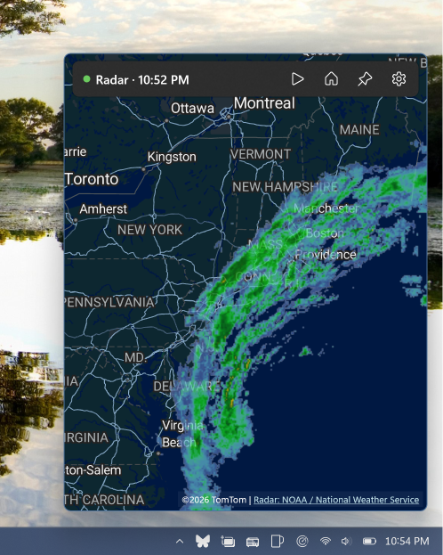

# Tray Radar



Click the tray icon to see live NWS weather radar, pan around, then click away and the flyout closes.

Tray Radar is a WinUI 3 app that lives in the Windows notification area. It has no main window: the tray icon opens a small, always-on-top flyout anchored next to the icon, showing the NOAA radar mosaic over an Azure Maps basemap.

## Features

- **Radar:** NOAA/NWS base reflectivity mosaic (`conus_bref_qcd` WMS from opengeo.ncep.noaa.gov), which is the same data as radar.weather.gov. The frame list refreshes every 2 minutes while the flyout is open.
- **Loop:** the toolbar's play button loops through up to 10 scans spaced at least 6 minutes apart, so roughly the last hour. A slider lets you scrub to a single frame.
- **Basemap:** Azure Maps, rendered with [WinUIEx.Maps](https://github.com/dotMorten/WinUIEx.Maps). Styles: match Windows theme, Road, Night, Grayscale, Satellite.
- **Location:** your device location or a US ZIP code. ZIP codes are looked up offline in the bundled Census ZCTA centroids.
- **Coverage:** the contiguous United States (lower 48) only.
- **Default view:** the pin button saves the current view as the one the flyout opens to. The home button returns to that view. Every open starts at the default view.
- **Light dismiss:** the flyout hides when it loses focus, and clicking the tray icon again toggles it.
- **Tray menu:** right-click the icon for Open radar, Settings, and Exit.
- **Settings:** location, basemap style, radar opacity, showing a pin at your location, resetting the default view, and Start with Windows.
- **Theme-aware tray icon:** a dark glyph on a light taskbar and a white glyph on a dark one. The icon follows the Windows (taskbar) theme, not the app theme, and switches live.
- **Single instance:** launching the app again opens the running instance's flyout instead of adding a second tray icon.
- **Offline handling:** when radar data can't be fetched, the flyout says so and retries every 30 seconds. When the connection returns, the frame layers are rebuilt so tiles that failed while offline load again.

## Install

Download [TrayRadar.appinstaller](https://github.com/TheJoeFin/tray-radar/releases/latest/download/TrayRadar.appinstaller) and open it. Windows installs the right version for your PC (x64 or ARM64), plus the Windows App Runtime if it's missing, and keeps Tray Radar up to date: it checks for a new release when the app starts and in the background.

- Requires Windows 10 1809 (build 17763) or later, x64 or ARM64.
- Installed 1.1.1 or earlier from the `.msix` files? Open the `.appinstaller` once. It upgrades the app in place, keeps your settings, and turns on automatic updates.

## Build from source

You need:

- [.NET 10 SDK](https://dotnet.microsoft.com/download).
- **Developer Mode** turned on (Settings > System > For developers), so the app can be registered with package identity.
- An [Azure Maps](https://learn.microsoft.com/azure/azure-maps/) subscription key for the basemap. It's optional: without one, the radar draws over a blank background.

### Setup

1. Copy `OAuth.resw.sample` to `OAuth.resw` in the repository root. `OAuth.resw` is gitignored.
2. Paste your Azure Maps key into the `AzureMapsKey` value in it.
3. From the repository root, build and run with package identity:

   ```powershell
   $Platform = if ($env:PROCESSOR_ARCHITECTURE -eq 'AMD64') { 'x64' } else { $env:PROCESSOR_ARCHITECTURE }
   dotnet run -c Debug -p:Platform=$Platform
   ```

   `dotnet run` goes through the `Microsoft.Windows.SDK.BuildTools.WinApp` package, which registers a loose-layout package with the [winapp CLI](https://github.com/microsoft/WinAppCli) and launches the app by AUMID. Package identity is required for settings storage (`ApplicationData`), the startup task, and resource loading.

On first run, an onboarding window asks where to center the radar. After that, the app runs from the tray only. Look in the taskbar overflow (^) if the icon is hidden.

To build without running:

```powershell
dotnet build -c Debug -p:Platform=$Platform
```

### Releases

1. Bump `Identity/@Version` in `Package.appxmanifest`, then commit and push.
2. From a PowerShell session that has the maintainer's `sign-msix` function, run `.\build-msix-for-gh.ps1`. It builds a signed x64 + ARM64 `.msixbundle` and the `TrayRadar.appinstaller` feed, checks them, and creates a draft GitHub release.
3. Publish the draft as the latest release without changing its tag (the feed's download addresses use it), then run `.\build-msix-for-gh.ps1 -VerifyPublished`.

`.\build-msix-for-gh.ps1 -SkipRelease -NoSign` checks the whole build without signing. The script is a copy of the one in the `winui-tray-app` skill; fix it there, not here.

## Project layout

| Path | What it holds |
|---|---|
| `App.xaml.cs` | Tray icon, context menu, single-instance mutex and "show flyout" event, crash logging |
| `Views/RadarFlyoutWindow` | The flyout: map, toolbar, frame slider, light dismiss, status messages |
| `Views/OnboardingWindow` | First-run location prompt |
| `Views/SettingsWindow` | Location, map, startup, and About settings |
| `Controls/LocationPicker` | Shared "device location or ZIP code" control used by onboarding and settings |
| `Controls/RadarAnimator.cs` | One tile layer per radar scan, loop playback, frame prefetch, periodic refresh |
| `Services/RadarService.cs` | Reads scan times from the WMS capabilities and builds tile URLs |
| `Services/LocationService.cs` | Device geolocation and the lower-48 bounding box |
| `Services/ZipLookupService.cs` | Offline ZIP code to coordinate lookup from `Assets/Data/zcta.csv` |
| `Services/SettingsService.cs` | Typed wrapper over `ApplicationData.LocalSettings` |
| `Services/WindowPlacementService.cs` | Positions the flyout next to the tray icon, whichever edge the taskbar is on |
| `Services/SystemThemeService.cs` | Watches the registry for Windows light/dark theme changes |
| `Services/StartupService.cs` | The MSIX startup task behind "Start with Windows" |
| `Services/ConnectivityService.cs` | Network status hints used to explain failed requests |
| `Services/Secrets.cs` | Reads the Azure Maps key from the compiled `OAuth` resources |
| `NativeMethods.txt` | Win32 APIs generated by [CsWin32](https://github.com/microsoft/CsWin32) |
| `tools/Build-ZipData.ps1` | Regenerates the ZIP code data |
| `build-msix-for-gh.ps1` | Builds, signs and verifies a release, and drafts it on GitHub |

## How it works

**Radar frames.** `RadarService` reads the `time` dimension from the WMS `GetCapabilities` response and keeps only listed scan times, because the service doesn't interpolate between scans. `RadarAnimator` adds one WinUIEx.Maps `TileLayer` per scan. Hidden frames stay at 0.001 opacity rather than 0, because WinUIEx.Maps skips loading tiles for fully transparent layers. That opacity is low enough to round to nothing when rendered. The map has no "tiles loaded" signal, so playback waits until a new frame has been prefetching for 4 seconds before showing it. That's what the buffering indicator means.

**Flyout placement.** WinUIEx's `TrayIcon` doesn't expose its message window, so `WindowPlacementService` reads it by reflection and calls `Shell_NotifyIconGetRect` to find the icon. If that fails, for example because the icon is in the overflow area or WinUIEx internals changed, it falls back to the cursor position and the taskbar edge.

**Settings.** All settings are stored in `ApplicationData.LocalSettings`. Every read falls back to a default, so a missing or corrupt value never crashes the app.

## ZIP code data

`Assets/Data/zcta.csv` is generated from the US Census Bureau ZCTA Gazetteer. It has `zip,lat,lon` rows for ZIP code areas inside the lower 48. To regenerate it:

```powershell
pwsh tools/Build-ZipData.ps1            # uses the 2025 Gazetteer
pwsh tools/Build-ZipData.ps1 -Year 2026 # a different year
```

The script's lower-48 bounding box must match `LocationService.IsInConus`.

## Troubleshooting

- **The map is blank but radar shows:** `OAuth.resw` is missing, or `AzureMapsKey` is empty. The key is compiled into the app's resources, so rebuild after adding it.
- **No radar or an offline message:** check that `opengeo.ncep.noaa.gov` is reachable. The app retries every 30 seconds.
- **"Use my device location" fails:** turn on location access in Settings > Privacy & security > Location, or enter a ZIP code.
- **The "Start with Windows" switch is disabled:** the app is running without package identity. Launch it with `dotnet run`.
- **The app crashes:** unhandled exceptions are appended to `%TEMP%\TrayRadar-crash.log`.
- **Launch fails because an old instance is running:** exit it from the tray menu, or run `taskkill /IM TrayRadar.exe /F`.
- **Remove the dev registration:** run `winapp unregister` from the repository root.

## Credits and licensing

- Radar data: NOAA / National Weather Service.
- Basemap: Azure Maps.
- ZIP code locations: US Census Bureau ZCTA Gazetteer.
- Map control: [WinUIEx.Maps](https://github.com/dotMorten/WinUIEx.Maps) by Morten Nielsen. Tray icon and window helpers: [WinUIEx](https://github.com/dotMorten/WinUIEx).
- The tray-only app pattern and flyout placement are adapted from [Traydio](https://github.com/TheJoeFin/Traydio).

WinUIEx.Maps is free for noncommercial use. Commercial use requires an active GitHub Sponsorship of dotMorten at $10/month or more. See the package's LICENSE.md.
